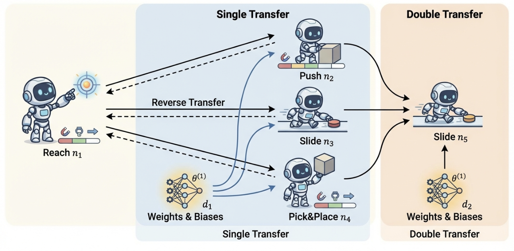
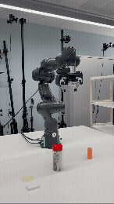

# Enhancing Deep Reinforcement Learning for Robotic Motion Planning via Task Decomposition

This repository provides DRL+TD training and evaluation code for Panda Gym tasks with obstacles (Push / Pick / Reach / Slide).


## Figures
**Main pipeline diagram**:



**Franka demo**:



## Main Results

Success rate (mean ± std over 3 runs) compared with DRL baselines (DDPG, TD3, SAC, TQC) across all tasks under obstacle and obstacle-free settings.

| Algorithm | Push (Obstacle) | Push (Obstacle-free) | Pick&Place (Obstacle) | Pick&Place (Obstacle-free) | Slide (Obstacle) | Slide (Obstacle-free) |
| --- | --- | --- | --- | --- | --- | --- |
| DDPG | 0.40 ± 0.27 | 0.93 ± 0.10 | 0.11 ± 0.19 | 0.16 ± 0.06 | 0.51 ± 0.25 | 0.64 ± 0.03 |
| TD3 | 0.16 ± 0.14 | 1.00 ± 0.01 | 0.23 ± 0.21 | 0.20 ± 0.04 | 0.31 ± 0.36 | 0.37 ± 0.32 |
| SAC | 0.43 ± 0.04 | 1.00 ± 0.01 | 0.33 ± 0.08 | 0.43 ± 0.03 | 0.84 ± 0.06 | 0.96 ± 0.03 |
| TQC | 0.77 ± 0.06 | **1.00 ± 0.00** | **0.67 ± 0.22** | 0.98 ± 0.02 | 0.73 ± 0.09 | 0.93 ± 0.04 |
| Ours | **0.83 ± 0.05** | **1.00 ± 0.00** | 0.57 ± 0.25 | **0.99 ± 0.01** | **0.95 ± 0.02** | **0.98 ± 0.01** |

## Installation

```bash
conda create -n panda-obstacle python=3.11
conda activate panda-obstacle
pip install -r requirements.txt
```

## Run
Run a training script directly, for example:

```bash
python PandaPickObstacle.py
```

If you use transfer / pre-trained model scripts, ensure the model paths exist (all are relative paths).

`PushAndPick_transfer.py` loads:
- `models/PandaReach/model`
- `models/PandaPick/model`
- `models/PandaPush2/model`

`Reach2Pick2Slide.py` loads:
- `models/PandaPickObstacle4_1/model`

`Reach2Push2Slide.py` loads:
- `models/PandaPushObstacle2m_3/model`

If your models are stored elsewhere, update the relative paths accordingly.

## Dependencies
See `requirements.txt`.

## Repro Steps
1. Choose a task script (e.g., `PandaPickObstacle.py`).
2. Prepare model files (if using transfer learning) under `models/`.
3. Run the script and save logs / figures.
