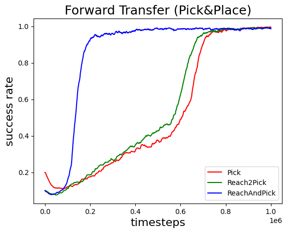
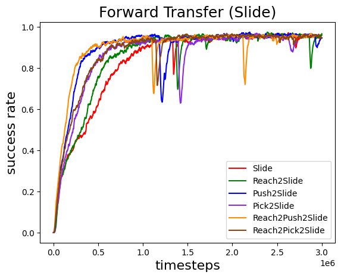
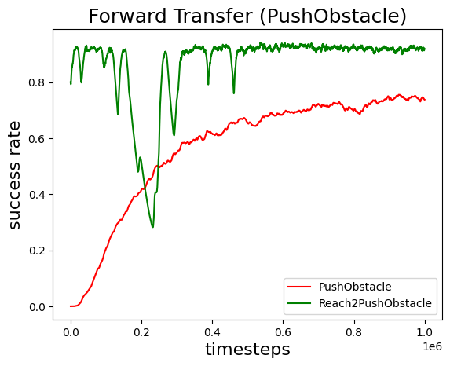
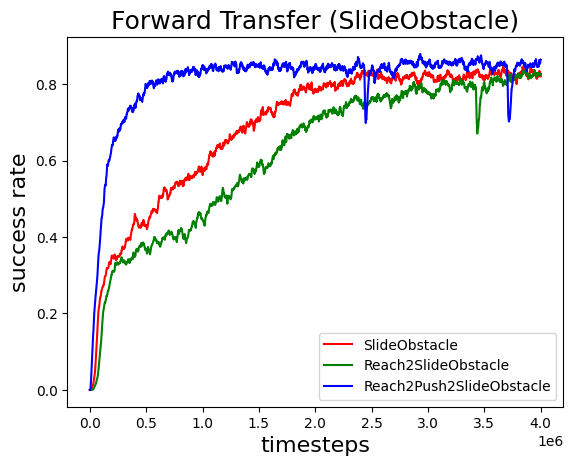
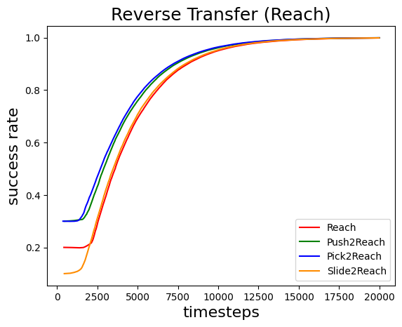

# Enhancing Deep Reinforcement Learning for Robotic Motion Planning via Task Decomposition

This repository provides DRL+TD training and evaluation code for Panda Gym tasks with obstacles (Push / Pick / Reach / Slide).


## Figures
**Main pipeline diagram**:


**Result figures**:

 
 


## Structure
- `envs/` task and environment definitions
- `models/` trained / pre-trained models used by scripts
- `trainer.py` training wrapper
- `tqc_panda.py` custom TQC implementation
- `demo/` pipeline and result figures

## Run
Run a training script directly, for example:

```bash
python PandaPickObstacle.py
```

If you use transfer / pre-trained model scripts, ensure the model paths exist (all are relative paths).

`PushAndPick_transfer.py` loads:
- `models/PandaReach/model`
- `models/PandaPick/model`
- `models/PandaPush2/model`

`Reach2Pick2Slide.py` loads:
- `models/PandaPickObstacle4_1/model`

`Reach2Push2Slide.py` loads:
- `models/PandaPushObstacle2m_3/model`

If your models are stored elsewhere, update the relative paths accordingly.

## Dependencies
See `requirements.txt` and `requirements_ros.txt`.

## Repro Steps
1. Choose a task script (e.g., `PandaPickObstacle.py`).
2. Prepare model files (if using transfer learning) under `models/`.
3. Run the script and save logs / figures.
